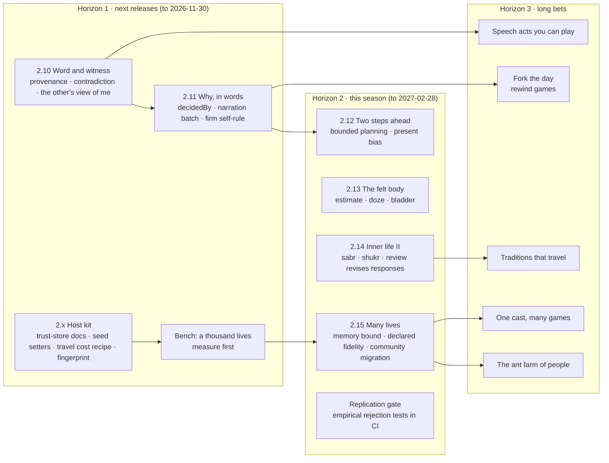

# HF roadmap: people you cannot see inside (2026-10-20)

Owner, 2026-10-20: "I also would like a cool roadmap for HF … so that we can push HF forward, instead of forgetting about it and delving into games." This page is that roadmap. It is a proposal: the owner sets goals, and nothing here starts unasked. [roadmap.md](roadmap.md) §3b stays the authoritative deferred list with targets; this page orders it, adds what the blind consultation found, and ends with a recommended next increment for the owner to approve. HF today is 2.9.0 / engine 2.9.0; the site and the external game repositories pin 2.8.0 or 2.9.0.

## Vision

**HF is the engine for people you cannot see inside: each one sees only part of the world, holds their own reasons and readings, and every choice they make replays exactly and explains itself.**

Games built on HF are about *understanding someone*: earning their trust, misreading them, being overruled by them, raising them, watching a town of them. The player never reads true numbers; the framework guarantees there is something true underneath, and a reason for every act.

Four threads carry the vision. Every item below belongs to one.

| Thread | What it means | Already strong | Thin or missing |
|---|---|---|---|
| **Partial sight** | What a person perceives, believes and is told, including what they believe others think | attention budget, credence beliefs, source trust, impressions one way (`glimpse`, `estimate`, `imagine`), perceived body (`readBody`), received consequences | belief provenance, contradiction, the other's view of me, perceived quantities, metacognition |
| **Readable reasons** | Every decision traceable to labelled terms; counterfactuals cheap | `DecisionRecord` terms with sources, `predictResponse`, `diffChronicle`, exact replay across platforms (`core/libm`) | why a suggestion lost (`decidedBy`), a fork-and-diff helper, narration variety |
| **Lives at length and scale** | Many people over many years, with saves that survive versions | yearbook, gists, character change, upbringing, `liveCommunity`, `migrate` | 1,000+ people, memory bounds, coarse/fine fidelity contract, community migration, portable persons |
| **The inner movement** | The Islam-guided spine: urge, noticing, assent or turning away, review, repair; lenses, never scalars | conscience, promptings (2.4.0), muhasaba (2.7.0), tawba as acts, no ruh quantity | sabr and shukr as appraisal styles, review that revises responses, held purpose, qalb lens |

## How this roadmap was made

1. **Blind consultation.** Three consultants read only a packet with the starting ambition (AGENTS.md history, goals and rules, the 2026-10-02 rebuild direction), `research/` and the owner's directions. Architecture, roadmap, HANDOFF, code and game docs were excluded. A computational cognitive scientist and a game-AI/simulation architect ran on Codex; a visionary contrarian ran on Opus. Raw outputs: [cognitive scientist](reviews/hf-blind-2026-10-20-codex-cogsci.md), [game-AI architect](reviews/hf-blind-2026-10-20-codex-gameai.md), [visionary](reviews/hf-blind-2026-10-20-opus-visionary.md).
   *What "blind" did not hide:* implementation-status passages were redacted (reconciliation §1 and §6, empirical-models §6b, one prayer-times line), but the research notes still name some modules and versions in passing (the 2.0 L-labels, `conscience/catalog.ts`, engine 1.9.0), and reconciliation §2–§5 describe lenses and held readings as decided. The consultants could therefore infer that a conscience catalog, promptings-style readings and long-run faculties exist. They could not see the module list, the API or the deferred lists.
2. **Reconciliation with what exists.** Each proposal was mapped against [framework.md](framework.md), [faculty-inventory.md](faculty-inventory.md), [roadmap.md](roadmap.md), the games' request files and the ledger (table in the appendix).
3. **Game demand.** The open asks of the games were compiled on 2026-10-20. Narration variety (Rope, Glance, Pass, with Valley's second-person recall and Warren 6 riding on the same batch), the social cluster from Stairwell and Hearsay (two direct provenance and lineage asks, Stairwell 4 and Hearsay 1, among about ten trust, belief and conversation asks), voice trust from acts (Valley, Pass) and scale or memory size (Valley, Warren) lead. Stairwell (8), Warren (6), Hearsay (3), Neighbours 3 and 4a and ledger N1 and N2 were not yet in §3b.

**Where the consultants converged.** All three put *partial sight* first or near first: a person acts on what they observed and were told, and holds fallible beliefs about others (visionary 1, cognitive 1 and 8, game-AI 5). Two or three named: a reason trace and fork-and-diff (visionary 4–5, game-AI 6), structured social moves (visionary 3, cognitive 8, game-AI bet), population scale with declared fidelity (visionary 6, game-AI 8), portable persons (visionary 10, game-AI bet), slow change through roles and upbringing (all three). HF already has the substrate for most of these; the gaps are named in the thread table above.

## Horizon 1: next releases (to 2026-11-30)

Each item ships opt-in or additive, with tests, one headless control in `packages/human/examples/`, a scope paragraph and exact legacy continuation (full-state digests of a person without the feature match the previous npm release, engine stamp normalized).

### 1.1 Engine 2.10, *Word and witness* (recommended next increment)

**What.** People know where their beliefs came from, notice when one source told different things, and hold a first-order belief about how another person sees them.
- **Provenance.** Optional `origin` and an opaque lineage token on a belief acquired from attended testimony; `converse` carries it into the next telling (Stairwell 4, Hearsay 1). The host owns the graph; HF owns the weighting.
- **Contradiction.** `contradicted(p, sourceId, prop, at)`: when the person has attended evidence that *one* source gave incompatible accounts of the same proposition (told them one thing and, as they learn by attending a third party, told another the opposite), that source's trust drops by a documented rule, asymmetric like `noteVoicePromise` (Stairwell 2; trust asymmetry already cited in empirical-models §6b). Two independent sources disagreeing is ordinary uncertainty and costs neither any trust.
- **The other's view of me** (§3b, "Engine 2.10"). A person holds a believed standing with another, moved only when *they themselves* have attended evidence that the other knows of their act: the other was present and seen to be present, or the person was told the other heard. A secret witness or a private relay the person never learns of leaves it unchanged. Read by `socialTerms` as a small bounded repair pull toward that person. Today a missed promise moves only the breaker's own record (`recordMissed` in `person.ts`, `byMe: true`, no relationship change); the promisee's relationship moves only if the host delivers a percept. 2.10 documents that delivery and keeps the promisee's relationship (`social.relationships`) apart from their impressions (`social.impressions`).
- **Setup API** (behaviour-neutral, may ship first as 2.x). `seedSourceTrust`, `seedBelief`, and one paragraph naming the three trust stores (relationship, voice, source) and what moves each (Stairwell 1, 7).

**Why.** It is the one capability all three blind consultants ranked at the top, and the largest untriaged cluster of game asks. It turns HF from people side by side into people who model each other.

**Unlocks.** Hearsay and The Stairwell drop their provenance-matching workarounds (they keep their own graphs and disclosure rules, and Stairwell keeps its word-gets-back rule); Good Hands (candidates read through says / heard / seen) and The Valley get honest reputation; future rumour, mediation and social-deduction games.

**Proof.**
- Tests, positive: a lineage token survives two relays unchanged and `origin` names the first teller; a source caught telling two listeners opposite things loses trust with a listener who attends both accounts, by the documented amount; a person seen breaking a promise by the promisee forms a lower believed standing and a repair pull toward them.
- Tests, negative: an absent person's belief does not change when the world fact changes (false belief); two independent sources disagreeing cost no trust; a secret witness or an unlearned private relay leaves believed standing unchanged; contradiction never raises trust and is order-independent within a batch; provenance metadata alone changes no decision (a separate metadata-preservation test through `snapshot`/`restore`).
- Headless control `examples/word-and-witness-control.ts`: four people for 20 days in two renamed domains. Day 3: A breaks a promise to B in front of B and C, and C is seen to see it. Day 5: D tells B and C opposite stories about A. Arms and expected results: *full*, where A's believed standing with B and C falls and A makes a repair offer to B within the week, and D loses trust with whichever of B and C attends both stories; *no believed standing*, the same beliefs and trust but no repair offer; *no contradiction*, D's trust unchanged; *no provenance*, identical decisions to *full*, with `origin` absent; *secret witness*, C hidden, so A's standing with C is unchanged.

**Not in it** (stays in §3b): word getting back to the subject (Stairwell 5), a per-person relay threshold (Stairwell 6), host trait tables for reputation (Stairwell 3), a voice's own acts moving trust (Valley 1) and `noteRequestAnswered` (Pass 5), which need a sourced effect size first.

### 1.2 HF 2.x, *Host kit* (behaviour-neutral; target 2026-11-01, the Valley triage date)

**What.** Documented recipes and small helpers that games keep rebuilding: travel or setup cost through `effort` and `duration`, and the fact that effort cost does not scale with duration (N1, Neighbours 3, Warren 2); the scale of `need:*` terms against effort and how to make work matter through `material` or goals (Warren 1); `fingerprint(person)` or a documented canonical form for saves (Valley 5); an opt-in tolerant `tellDeath` for listeners already past the death minute (Valley 4); notes on the community cache write-back (Warren 4) and on feeding residents in week-long hosts (Stairwell 8).

**Why.** The game-AI consultant's top adoption risk is authoring effort. Five games hit these independently.

**Proof.** A doc test per recipe that runs it in a minimal host and asserts its effect (a far water source loses to a near one once travel cost is declared; a 150-minute stint costs more than a 30-minute one under the recipe); `fingerprint(restore(snapshot(p))) === fingerprint(p)` for every fixture; tolerant `tellDeath` delivers at the listener's `now` (2.9.1 found the default already tolerant, so strict is the explicit `late: 'throw'`); the existing game regressions replay unchanged.

### 1.3 Engine 2.11, *Why, in words* (target 2026-11-30)

**What.** `SuggestionResolution.decidedBy` (inertia or the separating term, with margin; Pass 1); the narration batch already in §3b (per-person deferral and assent variants, plain third-person `promptingLine`, chronicle verbs that avoid inflecting nouns, second-person recall, varied lapse lines naming a cause such as `ordered`, and work narration that does not read `material` as money; Rope, Glance, Pass, Valley, Warren 6, N2); and the opt-in firm self-rule `Commitment.firm` (Pass 4).

**Why.** Narration variety is the most-requested change by game count (three games ask directly, two more ride on the batch), and "why won't she?" is the question every HF game has to answer without numbers.

**Proof.** Tests: `decidedBy` names the term whose removal would flip the verdict, or inertia; two people with different seeds or traits get different lines for the same decision; a firm rule refuses with reason `rule:<label>` and never at survival desperation. Headless control `examples/why-in-words-control.ts`: one suggestion refused across five arms (break inertia, a norm, a habit, a firm rule, fatigue), each `decidedBy` matching the arm, with narration fixtures re-recorded once for the batch.

### 1.4 Bench, *A thousand lives* (measure first; target 2026-11-15)

**What.** `npm run bench` gains 100, 1,000 and (coarse) 10,000 people through one disruption, reporting ms per person-day, bytes per person after 30 and 365 days, and decisions starved. Last recorded: 20 people × 30 days ≈ 1.8 s, about 3 ms per person-day (2026-10-04, engine 1.7.0 with libm, [findings](findings.md)); not re-measured on 2.9.0. Warren measures 4–10 ms per person per sim-day on 2.8.0; Valley saves about 90–100 KB per person after a month, 42 KB of it memory.

**Why.** The owner wants a game that "ticks off all the checkbox of why ant colony simulation ones are irresistible". Extrapolated from the 2026-10-04 figure, not measured: a town of 1,000 would need about 18 minutes per simulated year. Measure before optimizing; no change to decisions.

**Proof.** The bench itself, with numbers recorded in [findings.md](findings.md); a decision-hash check that the bench harness changes no results.

## Horizon 2: this season (to 2027-02-28)

| Item | What | Why | Unlocks | Proof (test + headless control) |
|---|---|---|---|---|
| **2.12 Two steps ahead** | Bounded multi-step planning over two or three received or known routes with waiting cost (§3b); person-level present bias over the 2.3.0 temporal goals | The most-cited missing faculty in the inventory; the cognitive scientist's "bounded thinking" | errands, expeditions, households that prepare; The Rope's descent | Test: a planner stopped at its budget cannot use an unexplored route. Control `examples/planning-control.ts`: time pressure crossed with an informative inspection; bounded planner vs reactive vs present-biased arms |
| **2.13 The felt body** | `estimateQuantity(p, { truth, difficulty })` (Glance 3 asked for `estimate`, which `social/impressions.ts` already exports for other people; value and confidence from body state; Glance 3); opt-in involuntary doze (Glance 2); bladder (Rope) | The "perceived twin" both consultants asked for; show, don't count, as an API | night watch, vigil and endurance games; honest readouts | Tests: `estimateQuantity` error grows with true sleepiness and difficulty and its confidence tracks perceived, not true, state; a doze starts only above a true-sleepiness threshold in a low-stimulation posture and a salient percept ends it; bladder urgency rises with intake and is relieved only by voiding. Control `examples/felt-body-control.ts`: a night of watching, rested vs sleep-restricted, with arms doze off, estimate off and bladder off, each removing its own effect only |
| **2.14 Inner life II** | Sabr and shukr as appraisal styles in `affect/` (attentional and regulatory effects only, P9, P12); review that revises a prompting response or method after failure (§3b, muhasaba follow-up); qalb lens for narration (2.x) | The reconciliation is HF's distinctive edge; two §7 slices are waiting | quiet inner lives in any game; Two Voices, Night Watch | Tests: a reappraising person's distress after a setback decays faster than a no-style person's, with the same choices available; after a prompting response fails three times, review replaces it with another practised response, and with review off it stays; a lens call changes neither state nor RNG and returns no number. Control `examples/inner-life-control.ts`: the same setback and the same repeated prompt for reappraising, grateful, ruminating and no-style persons over 30 days, with review on and off |
| **2.15 Many lives** | Memory bound in `Retention` (Valley 6); a declared-fidelity contract for coarse stepping (what is preserved exactly: promises, private knowledge, deaths); community-state migration steps (world state stays the host's; HF documents a host migration recipe, framework.md "What stays with the host") | The game-AI consultant: "scale achieved through silent semantic loss" is the trap | Valley at 60+ on phones; the ant farm | Test: coarse and fine stepping agree on preserved invariants exactly and on aggregate means within a stated tolerance. Control: one household moved repeatedly between fine and coarse stepping vs a fully fine reference |
| **Replication gate** | The six rejection tests of [empirical-models.md](../research/empirical-models.md) as headless controls in CI (sleep restriction without proportional awareness; a hungry person keeping a commitment; practised skill improving without universal transfer; the same person differing across settings; a supported person succeeding where the same capabilities alone fail; lifespan trajectories with different peaks), plus a published list of findings HF deliberately refuses (ego depletion as fuel) | The visionary's bet 4; the cognitive scientist's "confusing three achievements" | credibility outside the lab | The controls are the proof; a failing one is recorded in findings, not tuned away |
| **Culture as learned practice** (candidate; §3b review 2026-11-15 decides whether it enters this season) | Norm understanding and practices that diffuse between adults by exposure, with variation (inventory §14) | All three consultants named slow change through roles, upbringing and traditions | Good Hands, Valley, dynasty games | Test: a person exposed to two practices adopts each at rates ordered by exposure. Control: two siblings, 20 years, different seeds, different held readings |
| **Integration gate** | Once a horizon, a small new game built on the released HF with zero framework changes in a fixed time box; what it needs becomes the next horizon | The visionary's counter to "one faculty per release" | proves HF composes | The game, live, plus its list of framework asks |

## Horizon 3: long bets

Each bet names its risk and the first cheap experiment, which can run as a lab probe without an HF release.

| Bet | Picture | Risk | First cheap experiment |
|---|---|---|---|
| **Fork the day** | Snapshot a person or a town, change one thing, replay, and see where and why the lives diverge. Games about regret and rewinding; designers get a sensitivity map | chaotic divergence reads as noise | fork-and-diff over 20 seeds with one changed speech act; go if divergence times spread and each traces to a term (Game 2's "month you never spoke" is the existing proof of concept) |
| **One cast, many games** | A person exported from one game lives on in another, carrying memory and beliefs, with explicit semantic mappings | schema coupling across games | hand-move one Valley resident into a Good Hands week; record exactly what broke |
| **The ant farm of people** | 1,000–10,000 HF people, no player goal, gentle levers (a market day, a newcomer, a drought) | performance; emergence that looks dull | 200 people for a year after 2.15: do cliques, a trusted elder or a feud form unscripted? |
| **Speech acts you can play** | A small closed grammar (ask, offer, promise, refuse, warn, confide, praise, blame, lie) through each person's own loop; negotiation without an LLM | combinatorial authoring; bargaining exploits | three people negotiate one shift with one concealed constraint, compared with fixed dialogue choices (builds on 2.10) |
| **Traditions that travel** | Methods and practices taught, copied, revised and mis-taught across a village | culture reduced to copying | two repair methods, one demonstrator, one changed condition; imitation vs discovery vs frozen, including a bad method spreading (builds on `methods/`) |
| **Predicting real players** | The HF playtesters pre-register predicted quit and confusion points before opt-in runs arrive, and are scored | tiny, biased sample | before the next game's first 20 opt-in runs, write the predictions down; score them; record a miss honestly |
| **Lockstep-safe** | Two peers with different delivery delays reach identical per-tick hashes | float or ordering leaks | a two-harness lockstep run of the bench village (libm already makes platforms agree) |
| **A standalone game engine** (owner, 2026-10-20: "It may become a game engine like standalone tool in the future or whatever we need to make more games") | HF grows from a library games import into an engine-like tool: people, a host loop, saves, replays, playtesters and the lab kit as one starting point for a new game | becoming a generic engine and losing the people at its centre; the framework/game boundary blurs | after the Host kit, time-box one new game started from HF's recipes and kits alone, and list what it had to build that every game builds |

## Guardrails (what we will not build)

From the three consultants' "avoid" lists, where they agree with the project rules:
- **No scalar inner life.** A qalb, nafs, fitra or ʿaql lens is descriptive and categorical, cites its sources, is never comparable across persons and is never a decision input. Test with every lens: no state or RNG change.
- **No ruh, no verdicts.** Nothing computes divine acceptance, reward or forgiveness; restitution is an act, not an outcome. Rulings come from `research/`; a norm without a source stays pending.
- **No LLM in the loop**, including narration that feeds back into state. An LLM may render traces downstream.
- **No single currency.** No willpower fuel, global XP or one happiness score. Aggregation for a game is labelled a convention.
- **No silent semantic loss for speed.** Approximation is declared, versioned and measured.
- **No false precision.** Coefficients are engineering defaults; where results are sensitive to one, the doc says so.
- **No player modelling from telemetry.** A character's read of the player comes only from in-game acts.
- **HF playtesters are smoke tests, not judges**, until the prediction bet shows they predict people (the owner's "ouroboros" question).

## Recommended next bounded increment (for the owner to approve)

**HF 2.10.0 / engine 2.10.0, *Word and witness*** (§1.1), with the behaviour-neutral setup API and the *Host kit* recipes (§1.2) shipped first as a 2.x release.

- **Why this one.** It is where the blind consultants converged (all three put partial sight and beliefs about others at or near the top) and where the games' untriaged demand is largest (Stairwell, Hearsay; Good Hands and Valley benefit). It also closes a §3b item already targeted at engine 2.10, *the other's view of me*.
- **Done means.** HF 2.10.0 / engine 2.10.0 released on the HANDOFF release path after an independent review; tests and the `word-and-witness-control.ts` headless control as in §1.1; exact legacy continuation; existing-game regressions; the 2.x *Host kit* proofs of §1.2 passing; Stairwell 1, 2, 4 and 7 and Hearsay 1 recorded as done, and the rest of the Stairwell and Hearsay asks triaged into §3b with targets. The owner reviews afterwards. Horizon 1.3 and later are not started unasked.

## Current increment: curiosity and play, then bounded planning (owner, 2026-10-20)

Owner, 2026-10-20: "Add those faculties and other feat to HF." The island pilot ([experiment](lab/experiments/island-2026-10-20.md), "Rerun with the second adapter") found that an HF person with its needs met only rests more than random does, and that received consequences pull on one step before a goal but not on a walk, pick, carry and place chain. This increment answers both. It changes the order above: *Why, in words* moves from 2.11 to the next free minor after 2.12, and its target date stays 2026-11-30.

### Slice 1. HF 2.11.0 / engine 2.11.0, *Curiosity and play*

**What.** A new opt-in module `curiosity/`, owning `p.curiosity` (`enableCuriosity(p, spec?)` or `PersonSpec.enable.curiosity`). Absent, nothing runs and every save, replay and pinned game continues byte for byte. Present, `consider` adds up to three capped terms to an offer:

- `curiosity:unknown`: the pull of an option whose outcome the person cannot yet predict, read from the existing learned expectation (`1 − confidence` of `expectedEffect`). It fades as the person tries the option. No host novelty flag is needed.
- `curiosity:progress`: the pull of an option where the person's own prediction error is falling (learning progress). Each key keeps a fast and a slow average of prediction error from `finish`; progress is the slow average minus the fast one, floored at zero. An option that stays unpredictable (noise) earns only small, passing progress from chance runs.
- `curiosity:vary`: play as repetition with variation. An action kind done recently, offered again with a different target or place, gets a small pull; the identical repeat gets none.

All three are scaled by a relaxed-field gate (`1 −` the highest urgency among physiological needs and safety, times `1 −` fear), by temperament (openness) and by age (younger people explore more). A small intrinsic reward on `finish` feeds leisure and competence in proportion to learning progress. Boredom stays as it is: it still pulls toward host-tagged `novel` offers through affect; curiosity is a positive pull when needs are met, not a second boredom.

**Not in this slice.** Adopting a project from what is seen (roadmap.md §3b "Projects from what is seen" waits on the island rerun after 2.12). No LLM, no RNG in `consider`, no game-specific keys. Faith: no lens or mechanic; curiosity is not ʿaql, and nothing about the ruh is computed.

**Science.** [research/curiosity-and-play.md](../research/curiosity-and-play.md): intrinsic motivation and effectance, information gaps, learning progress, play criteria and play in development, openness, the explore–exploit shift with age.

**Proof.** Tests pin the gate, the three terms and the reward, exact legacy continuation (no slice, same digests and replay hashes) and the save round trip. Headless control `examples/curiosity-control.ts`: one person among familiar, unfamiliar-learnable and unfamiliar-noisy options for a day, in three arms. On with needs met, the person tries the unfamiliar options and then stays with the learnable one. Off with needs met, the person keeps to the familiar options. On with needs unmet, the person behaves like the off arm, because the gate closes.

### Slice 2. HF 2.12.0 / engine 2.12.0, *Steps ahead*

**What.** Opt-in bounded chains over retained consequences (`enablePlanning(p, { depth, presentBias? })`, owned by `prospection/`). Without it, received consequences keep their single successor exactly as in 2.3.0 to 2.11.0.

- **Chains.** A route links entries whose successor matches the next entry's trigger exactly (action, target, place). At most `depth` steps including the current action (2 to 5, default 4) and a fixed node budget (64 expansions), in stable source and id order, with no entry used twice. Each link multiplies its access probability, waits for its window and discounts by the goal's temporal half-life, so waiting costs value. One coherent route contributes per offer, as now.
- **Known consequences.** `seedConsequences(p, sourceId, claims)` is host setup, like `seedBelief`: what a person already knows about how their world works (channel `known`, weighted by stated confidence, not source trust). Nothing is inferred from the person's history.
- **Bounds.** With planning on, a person retains up to 64 entries and accepts batches of 16. Without it, the 2.3.0 bounds of 16 and 4 stay.
- **Present bias.** Optional quasi-hyperbolic β (0 < β ≤ 1) on goal value and cost that arrive only through later steps; absent, no bias.

**Not in this slice.** A general planner, search over the host's world, inferred procedures, plans that execute themselves, another person's agency.

**Proof.** Tests: a four-step chain gives the first step goal value with planning on and none with it off; a chain one step past `depth`, or past the node budget, gives none; present bias lowers chain value and leaves direct value alone; legacy continuation. Headless control `examples/planning-control.ts`: one goal reached through four steps (go, take, carry, put) in two renamed domains, with planner, reactive (planning off) and present-biased arms. The planner completes it; the reactive arm does not start it; the present-biased arm starts later or takes a nearer, smaller goal.

### Slice 3, if time allows

Picked after slices 1 and 2 by game demand, with the reason recorded here. The leading candidate is *project adoption from what is seen*, if the island rerun shows a person with curiosity and planning still builds nothing in free time.

### Per release

Focused tests, the headless control with its arms, exact legacy continuation and replay hashes, one independent Codex review with its findings fixed, `npm run release`, a check of npm provenance, the site pinned to the release and deployed, and the live `/release.json` checked. Receipts go in CHANGELOG.md and the release notes.

### Done means

2.11.0 and 2.12.0 published with CI green and the site live on 2.12.0, then the island rerun in `~/code/island` with the new faculties, reported plainly: does HF now play or build in free time, and does it complete the carry task?

## Review

A Codex adversarial review with repository access ([review](reviews/hf-roadmap-2026-10-20-codex-review.md)) found no faith-rule, determinism or LLM-in-loop violation and fourteen issues, all applied: contradiction now needs one source's incompatible accounts, not two sources disagreeing; believed standing needs the person's own evidence that the other knows; the claim that a promisee's impression already moves was wrong and is corrected; every proof now states positive outcomes and expected ablation results; tempted deliberate lying is recorded as existing (`converse`); the quantity API is renamed `estimateQuantity` to avoid the existing `estimate`; world migration stays with the host; bench figures are dated and the 1,000-person cost marked as an extrapolation; Warren 1 and 6 are mapped; culture is a candidate, not a commitment; and the done-means names Stairwell 1, 2, 4, 7 and Hearsay 1.

## Appendix: blind proposals against what exists

Status: **exists** (with where), **partial**, **gap → horizon**, **rejected** (with the rule).

| Proposal (consultant) | Status |
|---|---|
| Subjective perspective; beliefs from what was observed (cog 1, game-AI 5) | exists: `beliefs/` attention, credence, source trust; `prospection/` attended testimony only |
| Theory of mind, fallible beliefs about others (vis 1, cog 8) | partial: impressions one way (`glimpse`, `estimate`, `imagine`, `predictAs`); the other's view of me → H1 2.10 |
| Perceived twin of every slice (vis 2, cog 4) | partial: `readBody` true and perceived, perceived sleepiness; perceived quantities and skill confidence → H2 2.13 |
| Speech-act grammar (vis 3, game-AI bet) | partial: suggestions, commands, promises, `converse` testimony and advice, `noteVoicePromise`; full grammar → H3 |
| Reason trace on every decision (vis 4, game-AI 6) | exists: `DecisionRecord` terms with sources, `Term.ref`; `decidedBy` → H1 2.11; R/I/E/M/C labels per term → rejected for now (claim kinds live in module scope comments and `NormDef.sources`; per-term labels would bloat every trace) |
| Fork and diff (vis 5, game-AI 6) | partial: exact replay, `diffChronicle`, Game 2's counterfactual month (host-side); helper → H3 |
| Population scale with fidelity (vis 6, game-AI 8) | partial: `liveCommunity` by routine, `stepCommunity`; measured → H1 bench, contract → H2 2.15 |
| Reconstructive memory (vis 7, cog 3) | partial: episodes, gists, `retell`; no distortion or reconsolidation (inventory) → unscheduled; revisit after 2.15 |
| Concealment and lying as acts (vis 8) | exists in part: tempted deliberate deception in `converse` (selects a false claim against honesty and the `lying` norm, sourced Qur'an 9:119, and records the speaker's violation); `setReserve` and outward signs; a unified speech-act grammar and other forms of deception → H3 |
| Intergenerational transmission (vis 9, cog 10) | exists: `family/raise` (values, norm understanding, attachment); adults' norm change → H2 culture |
| Portable persons (vis 10, game-AI 3, bet) | exists: `snapshot`, `restore`, `migrate` for persons; community migration → H2 2.15; cross-game cast → H3 |
| Sustained intentions and reconsideration (cog 2, game-AI 4) | exists: activities, commitments, promises, `reconsider` (2.8.0), suggestion verdicts |
| Bounded thinking, metacognition (cog 5) | gap: planning → H2 2.12; metacognition unscheduled |
| Learning, habits, method revision (cog 6) | exists: `skills/`, `habits/`, `methods/`, muhasaba for commitments; revision of responses and methods → H2 2.14 |
| Emotion through appraisal and regulation (cog 7) | partial: OCC appraisal, regulation practice, reserve; sabr and shukr styles → H2 2.14 |
| Held norms, assent and repair (cog 9) | exists: `conscience/`, `promptings/`, tawba as acts |
| Deterministic contract (game-AI 1) | exists: seeded RNG in state, `core/libm`, cross-platform hashes; lockstep harness → H3 |
| Authoring language and validation (game-AI 2, 10) | partial: README, api.md, offer contract; recipes → H1 host kit; a conformance kit with the published playtester adapters → decide with the playtester publication (§3b, 2026-11-15) |
| Commitment lifecycle (game-AI 7) | exists: agenda, `fulfills` (2.9.0), cooperation records; group duty and renegotiation → §3b, review 2026-11-15 |
| Causal learning of the world (cog bet) | partial: conditional methods; causal model → H3 traditions |
| Credible life course (cog bet) | partial: life stages, chronic onsets, yearbook (opt-in); unscheduled beyond H2 |
| Playtesters should not grade games (vis avoid 1) | adopted as a guardrail; prediction bet → H3 |
| Fewer rule catalogs (vis avoid 5) | adopted: catalog depth only when a game needs it |
